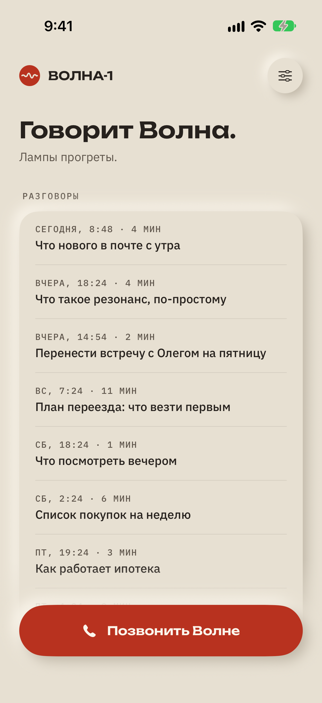
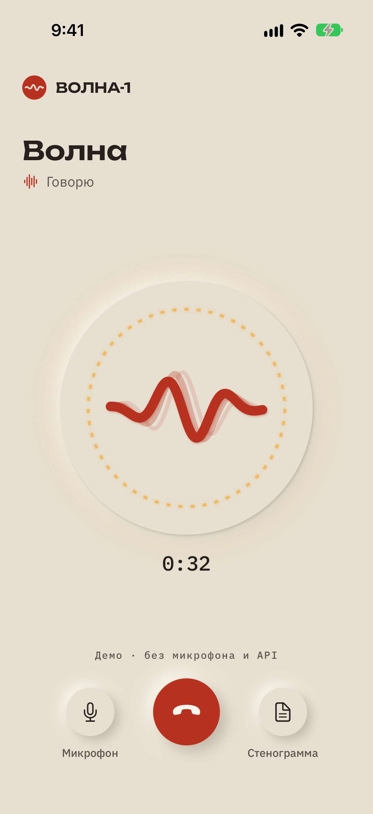
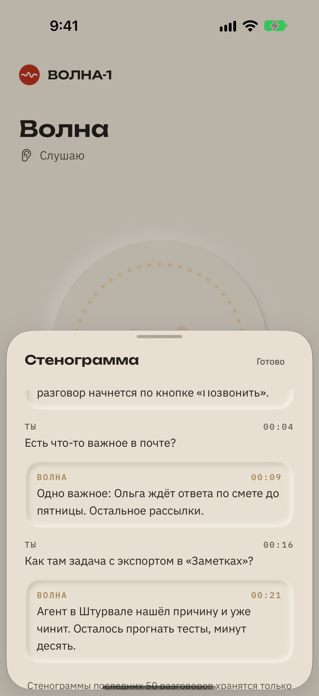
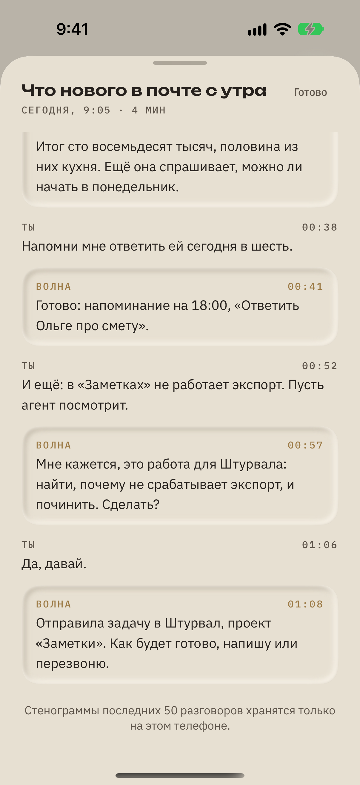
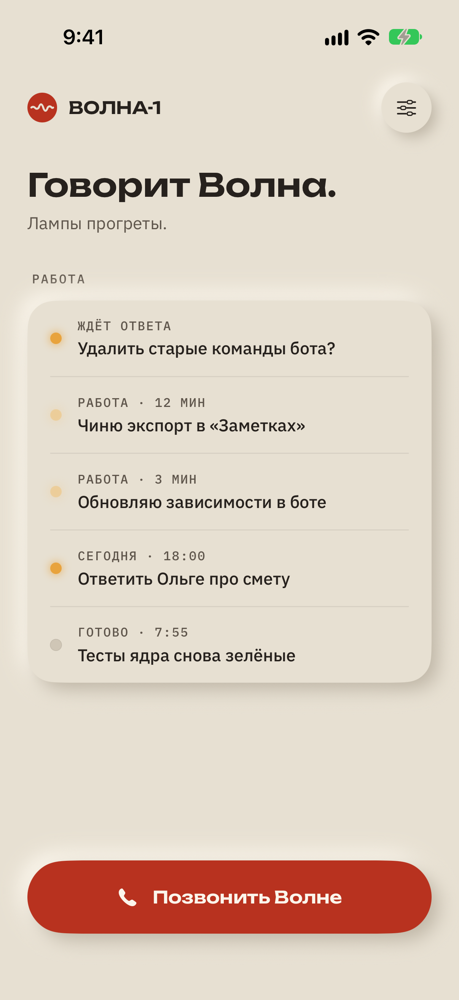

# Volna (Волна)

**English** · [Русский](README.ru.md)

A voice assistant for the iPhone that you **call like a person**. One tap, or "Hey Siri, call Volna", and you are in a live, full-duplex voice conversation that runs through CallKit like a real phone call. You can interrupt it, ask it to check your mail or set a reminder, and hand it real work: "fix the export in my notes app" starts a coding agent on your Mac through [Helm](#architecture), and Volna tells you when it is done.

<p align="center">
  
  
  
  
</p>
<p align="center"><sub>Home · in a call · live transcript · a past conversation. Real app in the iOS Simulator with made-up demo data; the UI is in Russian.</sub></p>

## Why

Voice assistants on the phone are either slow turn-taking chatbots or locked to one vendor's ecosystem. I wanted something that feels like ringing a capable colleague: it picks up instantly, you can cut in mid-sentence, it remembers what you told it last week, and when you ask for real work it starts that work on your computer and calls you back when it is done.

## What it does

- **Calls, not chats.** A system call through CallKit with proper audio routing (speaker by default, earpiece at your ear, Bluetooth respected), mute, a live transcript, and a SiriKit `INStartCallIntent` extension so Siri can start the call.
- **Full-duplex voice.** OpenAI's live voice model over WebRTC. Audio goes straight between the iPhone and OpenAI; the core only negotiates the session and listens on a sideband channel to run tools.
- **Mail by voice.** [mail-triage](https://github.com/SketchPiece/mail-triage) plugs into the core over MCP, so Volna can tell you what came in, read a message and mark it read.
- **Phone tools.** Reminders, calendar events and contacts through EventKit and Contacts, each only after you grant access; plus time, web search, recurring schedules and callbacks in the core. Tools are grouped into "tech cards" (skills) and routed to a cheap or a stronger model depending on the request.
- **Hands work to coding agents.** For bigger jobs Volna asks "I think this is one for Helm. Shall I?" and, on a yes, starts a thread in Helm on the Mac. It follows the job, brings the agent's questions into your next call, and reports back with a notification or by calling you (VoIP push). The home screen can show this work list instead of past talks.
- **Memory.** After each call the core extracts facts, preferences, episodes and open threads, groups them into cards (people, places, projects, interests) and consolidates them in a periodic "dream" pass. You choose how close it gets, from "remembers nothing" to "asks how your things are going".
- **Design.** A custom design system, "Bakelite and lamp": a warm ivory neumorphic body, one signal red, amber status lamps, and a wave mark that moves with the real call audio.

<p align="center">
  
</p>
<p align="center"><sub>The "Work" home screen: an agent waiting for an answer, jobs running in Helm, today's reminder, a finished job.</sub></p>

## Architecture

```
 iPhone app (SwiftUI)                    core/ (Node, Railway)                                         Mac
 ┌───────────────────────┐   HTTPS   ┌──────────────────────────┐ internal ┌────────────┐  WebSocket   ┌──────────────┐     ┌────────────┐
 │ CallKit · SiriKit     │──────────▶│ session · tools · memory │─────────▶│ helm-cloud │◀═════════════│ relay        │────▶│ Helm       │
 │ WebRTC audio          │           │ jobs · push · MCP client │ network  │ (Railway)  │  (outbound   │ LaunchAgent  │     │ (agents)   │
 │ EventKit · Contacts   │◀─ push ───│                          │          └────────────┘   from Mac)  └──────────────┘     └────────────┘
 └──────────┬────────────┘           └──────┬───────────┬───────┘
            │ WebRTC audio                  │ sideband  │ MCP (internal network)
            ▼                               ▼           ▼
        OpenAI live voice model ◀───────────┘       mail-triage
```

- **`ios/`**: the iPhone app (`CallAssistant.xcodeproj`), the Siri extension and tests. The call state lives in a single reducer (`CallEvent` → `CallReducer`); side effects stay in services. The app stores no API keys and no audio; the core token lives in the Keychain.
- **`core/`**: TypeScript on Node 22+ (no build step), Hono and zod. It creates the live voice session and exchanges SDP, answers the voice model's delegated requests with smaller models through OpenRouter, runs tools, stores memory, schedules callbacks, sends APNs pushes, and serves a local console with call timelines and costs. It reaches Helm through helm-cloud.
- **helm-cloud** (a separate repository): the cloud side of Helm, my desktop app for running coding agents. It holds the relay socket, a small MCP server so Claude can see and steer Helm threads, and Helm's own pushes and dictation. The relay is a tiny dependency-free Node helper that runs on the Mac as a LaunchAgent: it opens an outbound WebSocket to helm-cloud and executes a whitelisted set of calls against Helm. No inbound ports are opened on the Mac, and the relay never grants agent permissions on its own. The core reaches it over Railway's internal network.
- **Mail**: [mail-triage](https://github.com/SketchPiece/mail-triage) plugs into the core as an MCP plugin, so Volna can read and triage email by voice.
- **`archive/`**: retired experiments: "Pult", an earlier menu bar app for agent sessions, and a Speakerbox-based Siri/CallKit diagnostic.

More detail (Russian): [architecture](docs/architecture.md), [core](docs/core.md), [memory design](docs/memory-design.md), [tools routing](docs/tools-routing.md), [design system](docs/design/volna-design-system.html).

## Setup

Requirements: Xcode with an iOS 18+ simulator or device, Node.js 22.18+, an OpenAI API key with access to the live voice model, and an OpenRouter key.

1. **Core**

   ```sh
   cd core
   cp .env.example .env      # set OPENAI_API_KEY and OPEN_ROUTER_API_KEY
   npm ci
   npm start                 # http://127.0.0.1:8787
   ```

   Everything else (memory, push, Helm, MCP, Jev routing) is optional and documented inline in `.env.example`. Runtime data (memory, transcripts, metrics) is written to `core/data/`, which is gitignored.

2. **App**: open `ios/CallAssistant.xcodeproj`, choose the **CallAssistant** scheme and run. In Settings, turn on debug mode and point the core address at `http://127.0.0.1:8787`. **Settings → Open call demo** shows the call screen without a microphone or network, and launching with `--memory-preview` fills every screen with demo data (that is how the screenshots above were taken: `DesignScreenshots/testCaptureReadmeShots`).

3. **On a device** you need your own signing team and bundle IDs, an HTTPS URL for the core, and the same `BRIDGE_TOKEN` in the core and in the app. Callbacks need an APNs key. See [device setup](docs/device-setup.md).

4. **Helm (optional)**: locally the core talks to Helm directly with `HELM_TOKEN`. In the cloud it goes through helm-cloud: set `HELM_CLOUD_URL` and `HELM_INTERNAL_TOKEN`, and install the relay from the helm-cloud repository on the Mac.

Tests:

```sh
cd core && npm test && npm run typecheck
cd ios && xcodebuild -project CallAssistant.xcodeproj -scheme CallAssistant \
  -destination 'platform=iOS Simulator,name=iPhone 17 Pro' -derivedDataPath build test
```

Volna is a single-user prototype built for and tested on my own iPhone, and it is on hold for now. Docs are in Russian, as are the UI and prompts. It is not a public service: before anyone else used it, it would need real user accounts, quotas and proper secret management.

## License

[MIT](LICENSE) © 2026 Andrew Liubkin. Bundled fonts (Unbounded, IBM Plex) are under the SIL Open Font License 1.1; the archived Speakerbox diagnostic is based on Apple sample code under its own license.
