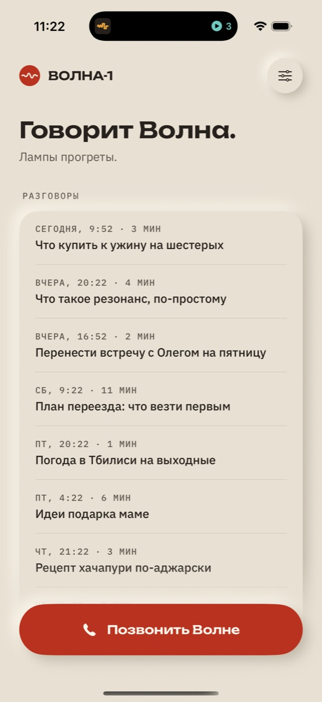

# Volna (Волна)

**English** · [Русский](README.ru.md)

A native iOS app that lets you *call* an AI. One tap, or "Hey Siri, call Volna", and you are in a live, full-duplex voice conversation that runs through CallKit like a real phone call. Behind the call sits a small cloud core that holds the keys, runs tools, keeps a long-term memory and can hand longer jobs to coding agents on your Mac.

> **Status: work in progress, paused.** Volna is a personal prototype that I built for and tested on my own iPhone, then put on hold. Many pieces are verified on a real iPhone, others only in the simulator or in tests, and some ideas are half-built. The docs (in Russian) record what was checked and what was not. Expect rough edges, hard-coded assumptions about a single owner, and Russian-first UI and prompts.

<p align="center">
  
</p>

## Why

Voice assistants on the phone are either slow turn-taking chatbots or locked to one vendor's ecosystem. I wanted something that feels like ringing a capable colleague: it picks up instantly, you can interrupt it, it remembers what you told it last week, and when you ask for real work ("fix the greeting in your own app") it starts that work on your computer and calls you back when it is done.

## What it does

- **Calls, not chats.** A system call through CallKit with proper audio routing (speaker by default, earpiece when the phone is at your ear, Bluetooth respected), mute, live transcript, and a SiriKit `INStartCallIntent` extension so Siri can start the call.
- **Full-duplex voice.** OpenAI's live voice model over WebRTC. Audio goes straight between the iPhone and OpenAI; the core only negotiates the session and listens on a sideband channel.
- **Tools.** Time, web search, memory, recurring schedules and callbacks in the core; reminders, calendar and contacts on the phone (EventKit / Contacts), each only after the user grants access. Tools are grouped into "tech cards" (skills) and routed to a cheap or a stronger model depending on the request.
- **Memory.** After each call the core extracts facts, preferences, episodes and open threads, groups them into cards (people, places, projects, interests), and periodically consolidates them in a "dream" pass. Four closeness levels, from "remembers nothing" to "asks how your things are going".
- **Background work.** "Do X in Work" starts a job on the Mac through Helm; Volna follows it, relays the agent's questions into the next call, and reports back with a notification or by calling you (VoIP push).
- **Design.** A custom design system, "Bakelite and lamp": a warm ivory neumorphic body, one signal red, amber status lamps, an animated wave mark driven by real call audio levels, light and dark themes.

## Architecture

```
 iPhone app (SwiftUI)                    core/ (Node, Railway)                     Mac
 ┌───────────────────────┐   HTTPS   ┌──────────────────────────┐   WebSocket   ┌──────────────┐     ┌────────────┐
 │ CallKit · SiriKit     │──────────▶│ session · tools · memory │◀══════════════│ relay/       │────▶│ Helm       │
 │ WebRTC audio          │           │ jobs · push · MCP        │  (outbound    │ LaunchAgent  │     │ (agents)   │
 │ EventKit · Contacts   │◀─ push ───│                          │   from Mac)   └──────────────┘     └────────────┘
 └──────────┬────────────┘           └──────┬───────────┬───────┘
            │ WebRTC audio                  │ sideband  │ MCP (internal network)
            ▼                               ▼           ▼
        OpenAI live voice model ◀───────────┘       mail-triage
```

- **`ios/`**: the iPhone app (`CallAssistant.xcodeproj`), the Siri extension and tests. The call state lives in a single reducer (`CallEvent` → `CallReducer`); side effects stay in services. The app stores no API keys and no audio; the core token lives in the Keychain.
- **`core/`**: TypeScript on Node 22+ (no build step), Hono and zod. It creates the live voice session and exchanges SDP, answers the voice model's delegated requests with smaller models through OpenRouter, runs tools, stores memory, schedules callbacks, sends APNs pushes, and serves a local console with call timelines and costs. It also exposes a small MCP server so Claude can see and steer Helm threads.
- **`relay/`**: a tiny dependency-free Node helper that runs on the Mac as a LaunchAgent. It opens an outbound WebSocket to the cloud core and executes a whitelisted set of calls against Helm, my desktop app for running coding agents. No inbound ports are opened on the Mac, and the relay never grants agent permissions on its own.
- **Mail**: [mail-triage](https://github.com/SketchPiece/mail-triage) plugs into the core as an MCP plugin, so Volna can read and triage email by voice.
- **`archive/`**: retired experiments: "Pult", an earlier menu bar app for agent sessions, and a Speakerbox-based Siri/CallKit diagnostic.

More detail (Russian): [architecture](docs/architecture.md), [core](docs/core.md), [relay](docs/relay.md), [memory design](docs/memory-design.md), [tools routing](docs/tools-routing.md), [design system](docs/design/volna-design-system.html).

## Setup

Requirements: Xcode with an iOS 18+ simulator or device, Node.js 22.18+, an OpenAI API key with access to the live voice model, and an OpenRouter key.

1. **Core**

   ```sh
   cd core
   cp .env.example .env      # set OPENAI_API_KEY and OPEN_ROUTER_API_KEY
   npm ci
   npm start                 # http://127.0.0.1:8787
   ```

   Everything else (memory, push, Helm, MCP, Jev routing) is optional and documented inline in `.env.example`. Runtime data (memory, transcripts, metrics) is written to `core/data/`, which is gitignored.

2. **App**: open `ios/CallAssistant.xcodeproj`, choose the **CallAssistant** scheme and run. In Settings, turn on debug mode and point the core address at `http://127.0.0.1:8787`. **Settings → Open call demo** shows the UI without a microphone or network.

3. **On a device** you need your own signing team and bundle IDs, an HTTPS URL for the core, and the same `BRIDGE_TOKEN` in the core and in the app. Callbacks need an APNs key. See [device setup](docs/device-setup.md).

4. **Relay (optional)**: `cd relay && cp .env.example .env`, set `CORE_URL`, `RELAY_TOKEN` and `HELM_TOKEN`, then `./launchd.sh install`.

Tests:

```sh
cd core && npm test && npm run typecheck
cd ios && xcodebuild -project CallAssistant.xcodeproj -scheme CallAssistant \
  -destination 'platform=iOS Simulator,name=iPhone 17 Pro' -derivedDataPath build test
cd relay && node --test 'src/**/*.test.ts'
```

This is a single-user prototype, not a public service: before anyone else used it, it would need real user accounts, quotas and proper secret management.

## License

[MIT](LICENSE) © 2026 Andrew Liubkin. Bundled fonts (Unbounded, IBM Plex) are under the SIL Open Font License 1.1; the archived Speakerbox diagnostic is based on Apple sample code under its own license.
